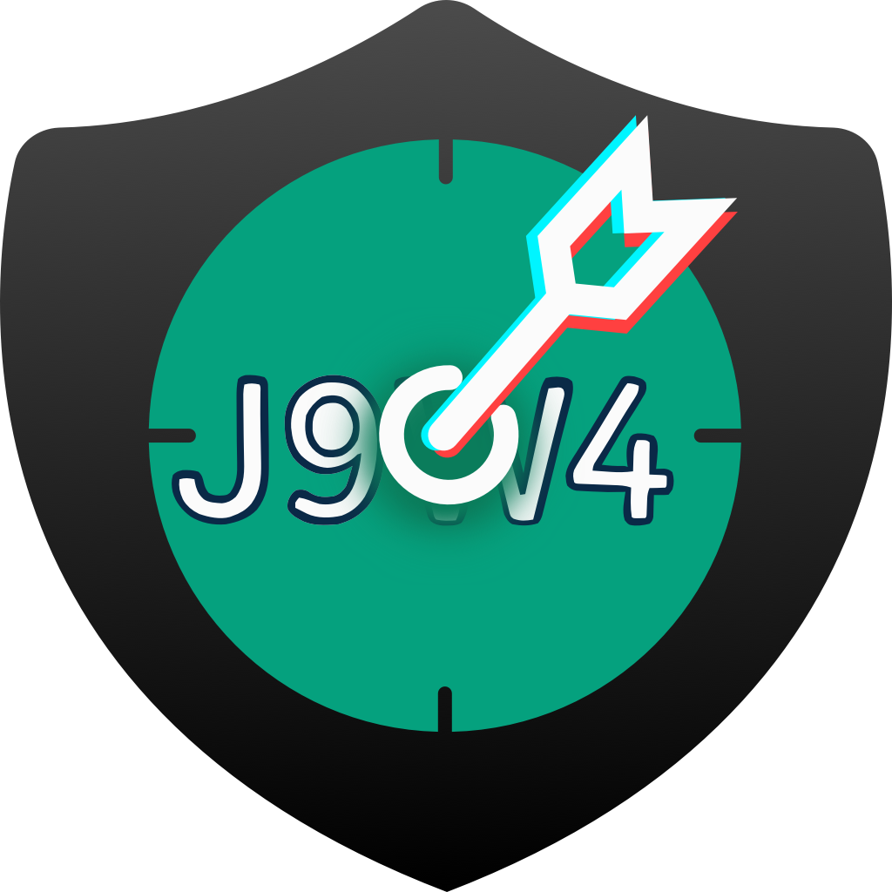

<div align="center">
  <a href="https://github.com/Hiram-Wong/captcha-bypass">
    
  </a>
</div>

<div align="center">
  <p><b><font size="4"><i>Captcha Bypass</i></font></b></p>
</div>

<div align="center">

[![][github-release-shield]][github-release-link]
[![][github-license-shield]][github-license-link]
[![][github-docker-shield]][github-docker-link]
[![][platform-shield]][github-link]

</div>
<div align="center">

[![][deepwiki-shield]][deepwiki-link]
[![][zread-shield]][zread-link]

</div>

## 介绍

**Captcha Bypass** 是一个跨平台的验证码识别服务，基于 `onnxruntime-web` 完成 ONNX 模型推理，通过 [Bun](https://bun.sh) 编译为独立二进制。支持目标检测、文字识别、旋转验证码、滑块验证码四类能力，提供 **CLI** 与 **HTTP Server** 两种运行方式，并可打包为 **MCP** 包供 AI 客户端调用。

### 核心特性

- **跨平台**：单份二进制，覆盖 Linux / Windows / macOS / Android 四类平台（amd64 + arm64）。
- **双运行模式**：CLI 模式适合脚本化调用，Server 模式提供 HTTP 接口与 OpenAPI 文档。
- **可插拔模型**：支持自定义 ONNX 模型，路径与超参均通过环境变量配置。
- **AI加成**：可选接入大模型（OpenAI / Anthropic / Google / Ollama 等）完成文字与算术验证码识别。

## 快速开始

### 方式一：二进制 + 模型

1. 从 [Releases][github-release-link] 下载对应平台的二进制、`models.zip` 模型文件及 `public.zip` 静态资源。
2. 将二进制（建议重命名）与 `models/`、`public/` 放在同一目录：

```
captcha-bypass/
├── captcha-bypass                 # 按实际平台替换，如 captcha-bypass-mac-arm64
├── models/
│   ├── detect.onnx
│   ├── ocr_dddd.onnx
│   ├── ocr_dddd.json
│   ├── ocr_pp.onnx
│   ├── ocr_pp.json
│   └── rotate.onnx
└── public/                        # 可选，静态资源
    ├── favicon.ico
    └── robots.txt
```

3. 启动：

```bash
# CLI 模式（仅需结果时指定 LOG_LEVEL=none）
./captcha-bypass cli captcha ocr --type text --bg https://example.com/captcha.png   # Mac / Linux
.\captcha-bypass.exe cli captcha ocr --type text --bg https://example.com/captcha.png # Windows

# Server 模式
./captcha-bypass server          # Mac / Linux
.\captcha-bypass.exe server      # Windows
```

> 模型文件通过环境变量指定；未设置时默认加载二进制同级 `models/` 目录下的对应文件。

### 方式二：Docker

```bash
# 拉取镜像
docker pull ghcr.io/hiram-wong/captcha-bypass:latest

# CLI 模式
docker run --rm ghcr.io/hiram-wong/captcha-bypass:latest ./captcha-bypass cli captcha ocr --type text --bg https://example.com/captcha.png

# Server 模式
docker run -d -p 7788:7788 ghcr.io/hiram-wong/captcha-bypass:latest
```

> 镜像内置模型，开箱即用；通过 `-e` 传入环境变量覆盖配置。如需自定义模型或日志落盘，参考仓库内 `docker-compose.yml`。

## 使用

### 支持的能力

| 能力       | 接口              | 方法 | 模式         | 说明                                   |
| :--------- | :---------------- | :--- | :----------- | :------------------------------------- |
| 目标检测   | `/captcha/detect` | POST | CLI / Server | 识别图中目标位置，或匹配目标与背景     |
| 文字识别   | `/captcha/ocr`    | POST | CLI / Server | 识别文本或算术验证码（支持 AI 兜底）   |
| 旋转验证码 | `/captcha/rotate` | POST | CLI / Server | 计算旋转角度（单图 / 双圆 / 拼图）     |
| 滑块验证码 | `/captcha/slide`  | POST | CLI / Server | 计算滑块偏移坐标（匹配 / 对比）        |
| 健康检查   | `/health`         | GET  | CLI / Server | 存活探测；CLI 下为 `cli health` 子命令 |
| OpenAPI    | `/docs`           | GET  | Server       | 需启用 `OPENAPI_ENABLE`（默认关闭）    |

### 参数与调用

各能力的参数语义、响应格式、图片输入方式与调用示例，统一维护在 [skill 参考文档](./packages/skills/captcha-bypass/references/) 中：

| 文档                                                                             | 内容                                       |
| :------------------------------------------------------------------------------- | :----------------------------------------- |
| [api_reference.md](./packages/skills/captcha-bypass/references/api_reference.md) | 能力定义、参数语义、响应格式、图片输入方式 |
| [cli.md](./packages/skills/captcha-bypass/references/cli.md)                     | CLI 调用指引与示例                         |
| [server.md](./packages/skills/captcha-bypass/references/server.md)               | Server 调用指引与示例（含鉴权说明）        |

核心约定：CLI 模式无鉴权，支持 Base64 / URL / 本地文件路径；Server 模式按需启用 `Bearer Token` 鉴权，支持 Base64 / URL / 文件上传。

### MCP 集成

MCP 服务遵循 [Model Context Protocol](https://modelcontextprotocol.io)，以独立打包的 `.mcpb` 包（`captcha-bypass.mcpb`）随版本发布，可在任意支持 MCP 的客户端（如 Claude Desktop、WorkBuddy 等）中安装使用。

#### 安装与配置

从 [Releases][github-release-link] 下载 `captcha-bypass.mcpb`，安装到你的 MCP 客户端后，配置以下参数指向一个已运行的服务：

| 配置项  | 说明                                                  | 默认值           |
| :------ | :---------------------------------------------------- | :--------------- |
| baseURL | HTTP 服务地址                                         | `127.0.0.1:7788` |
| token   | 服务端 `AUTH_KEYS` 中的任一 key（服务启用认证时必填） | 空               |
| timeout | 单次识别请求超时（毫秒）                              | `120000`         |

#### 暴露的工具

| 工具名           | 说明                                     | 对应接口          |
| :--------------- | :--------------------------------------- | :---------------- |
| `captcha_ocr`    | 文字 / 算术验证码识别（onnx 或 ai 引擎） | `/captcha/ocr`    |
| `captcha_rotate` | 旋转验证码角度检测（single/nox/tiktok）  | `/captcha/rotate` |
| `captcha_slide`  | 滑块验证码位置匹配                       | `/captcha/slide`  |
| `captcha_detect` | 目标检测（YOLO 检测或匈牙利匹配）        | `/captcha/detect` |
| `health`         | 检查远程服务健康状态                     | `/health`         |

### Skill 使用

项目同时提供一个 **Skill**，随版本发布，供 AI Agent（如 Claude Code、WorkBuddy 等）在对话中直接调用验证码识别能力。

Skill 通过环境变量约定运行方式（`CAPTCHA_TYPE`：cli / server 模式、`CAPTCHA_BIN`：二进制路径或服务 URL、`CAPTCHA_KEY`：鉴权 key），首次使用时由 Agent 引导初始化，详见 [SKILL.md](./packages/skills/captcha-bypass/SKILL.md)。

## 配置

所有配置均通过环境变量设置，参考 `.env.example` 。

| 配置               | 类型                                                                           | 默认值                | 说明                                                                                           |
| :----------------- | :----------------------------------------------------------------------------- | :-------------------- | :--------------------------------------------------------------------------------------------- |
| NODE_ENV           | `"development"` \| `"production"`                                              | production            | 运行环境                                                                                       |
| LOG_LEVEL          | `"silly"` \| `"debug"` \| `"info"` \| `"warn"` \| `"error"` \| `"none"`        | none                  | 日志级别（从低到高），`none` 表示不输出日志                                                    |
| PORT               | `number`                                                                       | 7788                  | 服务端口（仅 server 模式）                                                                     |
| OPENAPI_ENABLE     | `boolean`                                                                      | false                 | 是否启用 OpenAPI 文档（仅 server 模式）                                                        |
| AUTH_KEYS          | `string[]`（JSON 数组）                                                        | `[]`                  | 认证密钥列表；空数组不启用认证；启用后请求需携带 `Authorization: Bearer <key>`（任一匹配即可） |
| DETECT_MODEL_PATH  | `string`                                                                       | `models/detect.onnx`  | Detect 模型路径                                                                                |
| DETECT_SHAPE       | `number[]`                                                                     | `[3,416,416]`         | 模型输入尺寸 `[C,H,W]`                                                                         |
| DETECT_MEAN        | `number[]`                                                                     | `[0,0,0]`             | 均值标准化                                                                                     |
| DETECT_STD         | `number[]`                                                                     | `[1,1,1]`             | 标准差标准化                                                                                   |
| OCR_MODEL_PATH     | `string`                                                                       | `models/ocr_pp.onnx`  | OCR 模型路径（ppocr / ddddocr）                                                                |
| OCR_CHARSET_PATH   | `string`                                                                       | `models/ocr_pp.json`  | OCR 字符集路径                                                                                 |
| OCR_CHARSET_RANGES | `string`                                                                       | 空字符串              | 字符集范围过滤，如 `"0123456789"`                                                              |
| OCR_SHAPE          | `number[]`                                                                     | `[3,48,320]`          | 模型输入尺寸 `[C,H,W]`（ppocr `[3,48,320]` / ddddocr `[1,64,0]`）                              |
| OCR_MEAN           | `number`                                                                       | `0.5`                 | 均值标准化                                                                                     |
| OCR_STD            | `number`                                                                       | `0.5`                 | 标准差标准化                                                                                   |
| OCR_CTC_LAYOUT     | `"ntc"` \| `"tnc"`                                                             | `ntc`                 | CTC 布局（ppocr ntc / ddddocr tnc）                                                            |
| ROTATE_MODEL_PATH  | `string`                                                                       | `models/rotate.onnx`  | ROTATE 模型路径                                                                                |
| ROTATE_SHAPE       | `number[]`                                                                     | `[3,224,224]`         | 模型输入尺寸 `[C,H,W]`                                                                         |
| ROTATE_MEAN        | `number[]`                                                                     | `[0.485,0.456,0.406]` | 均值标准化                                                                                     |
| ROTATE_STD         | `number[]`                                                                     | `[0.229,0.224,0.225]` | 标准差标准化                                                                                   |
| AI_TYPE            | `"anthropic"` \| `"google"` \| `"ollama"` \| `"openai"` \| `"openai-response"` | openai                | AI 服务类型                                                                                    |
| AI_BASE_URL        | `string`                                                                       | 空字符串              | AI API 地址                                                                                    |
| AI_API_KEY         | `string`                                                                       | 空字符串              | AI API 密钥                                                                                    |
| AI_OCR_MODEL       | `string`                                                                       | PaddleOCR-VL-1.6      | OCR 专用模型名（推荐：PaddleOCR、HunyuanOCR、DeepSeek-OCR）                                    |
| AI_MODEL           | `string`                                                                       | gpt-5.5               | 通用模型名                                                                                     |

## 常见问题

<details>
<summary>展开查看</summary>

#### 识别不准确？

- 使用 onnx 部分由模型决定，可自行使用 [dddd_trainer](https://github.com/sml2h3/dddd_trainer) 训练特定场景专属模型。
- 使用 opencv 部分为非通用场景，特定场景需自行完成算法匹配。

#### 算术识别不准确？

- 算术识别同样与模型挂钩。
- 仅支持整数四则运算（加减乘除），不支持取余、开方等其他运算。
- onnx：对 `+` 与 `*` 错误率较高，建议按给出的公式手动核对符号后再次计算。
- ai：部分模型对提示词理解能力较弱，字符集范围可能不生效。

</details>

## 开发

> 需先安装 [Bun](https://bun.com/docs/installation)

```bash
cp .env.example .env                 # 复制环境变量配置
bun install                          # 安装依赖
bun run server                       # 开发模式（server）
bun run cli                          # 开发模式（cli）
bun run build:{win|mac|linux|android}:{arch}   # 构建二进制，如 bun run build:mac:arm64
bun run build:mcpb                   # 构建 MCP 包（.mcpb）
```

## 许可

PP_OCR 模型版权归 [PaddlePaddle](https://github.com/PaddlePaddle/PaddleOCR) 所有，DDDD_OCR 模型版权归 [ddddocr](https://github.com/sml2h3/ddddocr) 所有，其余工程代码版权归本仓库所有者所有。本项目采用 [MIT License](./LICENSE) 许可。

使用本项目即表示您已阅读并同意以下条款（谁使用，谁负责）：

1. **合法使用**：不得将本项目用于任何违法、违规或侵犯他人权益的行为，包括但不限于网络攻击、诈骗、绕过身份验证、未经授权的数据抓取等。
2. **风险自负**：任何因使用本项目而产生的法律责任、技术风险或经济损失，由使用者自行承担，项目作者不承担任何形式的责任。
3. **禁止滥用**：不得将本项目用于违法牟利、黑产活动或其他不当商业用途。

如本项目对您的研究有所帮助，欢迎引用：

```bibtex
@misc{captcha-bypass,
  title={Captcha Bypass},
  author={Hiram Wong},
  year={2026},
  url={https://github.com/Hiram-Wong/captcha-bypass},
}
```

## 鸣谢

- [onnxruntime-web](https://github.com/microsoft/onnxruntime-web) - 模型推理
- [@techstark/opencv-js](https://github.com/TechStark/opencv-js) - OpenCV
- [PaddleOCR](https://github.com/PaddlePaddle/PaddleOCR) - 文字识别模型
- [ddddocr](https://github.com/sml2h3/ddddocr) - 文字识别 / 目标检测模型 / 滑块匹配算法
- [ddddocr (pr 259)](https://github.com/k23223/ddddocr) - 单图矫正模型
- [JJBJJ](https://github.com/JJBJJ) - 双图 Nox 算法
- [来一碗清茶 (CSDN)](https://blog.csdn.net/u011931957/article/details/147661195) - 双图 Tiktok 算法

<!-- Links & Images -->

[github-link]: https://github.com/Hiram-Wong/captcha-bypass
[github-release-shield]: https://img.shields.io/github/v/release/Hiram-Wong/captcha-bypass?label=Release&logo=github
[github-release-link]: https://github.com/Hiram-Wong/captcha-bypass/releases
[github-docker-shield]: https://img.shields.io/badge/dynamic/json?url=https://ghcr-badge.elias.eu.org/api/Hiram-Wong/captcha-bypass/captcha-bypass&query=%24.downloadCount&logo=docker&label=Docker%20Pulls
[github-docker-link]: https://github.com/Hiram-Wong/captcha-bypass/pkgs/container/captcha-bypass
[github-license-shield]: https://img.shields.io/github/license/Hiram-Wong/captcha-bypass?label=License&logo=appveyor
[github-license-link]: https://github.com/Hiram-Wong/captcha-bypass/blob/main/LICENSE
[platform-shield]: https://img.shields.io/badge/OS-Linux%2C%20Win%2C%20Mac-blue.svg

<!-- Links & Images -->

[deepwiki-shield]: https://deepwiki.com/badge.svg
[deepwiki-link]: https://deepwiki.com/Hiram-Wong/captcha-bypass
[zread-shield]: https://img.shields.io/badge/Ask_Zread-_.svg?style=flat&color=00b0aa&labelColor=000000&logo=data%3Aimage%2Fsvg%2Bxml%3Bbase64%2CPHN2ZyB3aWR0aD0iMTYiIGhlaWdodD0iMTYiIHZpZXdCb3g9IjAgMCAxNiAxNiIgZmlsbD0ibm9uZSIgeG1sbnM9Imh0dHA6Ly93d3cudzMub3JnLzIwMDAvc3ZnIj4KPHBhdGggZD0iTTQuOTYxNTYgMS42MDAxSDIuMjQxNTZDMS44ODgxIDEuNjAwMSAxLjYwMTU2IDEuODg2NjQgMS42MDE1NiAyLjI0MDFWNC45NjAxQzEuNjAxNTYgNS4zMTM1NiAxLjg4ODEgNS42MDAxIDIuMjQxNTYgNS42MDAxSDQuOTYxNTZDNS4zMTUwMiA1LjYwMDEgNS42MDE1NiA1LjMxMzU2IDUuNjAxNTYgNC45NjAxVjIuMjQwMUM1LjYwMTU2IDEuODg2NjQgNS4zMTUwMiAxLjYwMDEgNC45NjE1NiAxLjYwMDFaIiBmaWxsPSIjZmZmIi8%2BCjxwYXRoIGQ9Ik00Ljk2MTU2IDEwLjM5OTlIMi4yNDE1NkMxLjg4ODEgMTAuMzk5OSAxLjYwMTU2IDEwLjY4NjQgMS42MDE1NiAxMS4wMzk5VjEzLjc1OTlDMS42MDE1NiAxNC4xMTM0IDEuODg4MSAxNC4zOTk5IDIuMjQxNTYgMTQuMzk5OUg0Ljk2MTU2QzUuMzE1MDIgMTQuMzk5OSA1LjYwMTU2IDE0LjExMzQgNS42MDE1NiAxMy43NTk5VjExLjAzOTlDNS42MDE1NiAxMC42ODY0IDUuMzE1MDIgMTAuMzk5OSA0Ljk2MTU2IDEwLjM5OTlaIiBmaWxsPSIjZmZmIi8%2BCjxwYXRoIGQ9Ik0xMy43NTg0IDEuNjAwMUgxMS4wMzg0QzEwLjY4NSAxLjYwMDEgMTAuMzk4NCAxLjg4NjY0IDEwLjM5ODQgMi4yNDAxVjQuOTYwMUMxMC4zOTg0IDUuMzEzNTYgMTAuNjg1IDUuNjAwMSAxMS4wMzg0IDUuNjAwMUgxMy43NTg0QzE0LjExMTkgNS42MDAxIDE0LjM5ODQgNS4zMTM1NiAxNC4zOTg0IDQuOTYwMVYyLjI0MDFDMTQuMzk4NCAxLjg4NjY0IDE0LjExMTkgMS42MDAxIDEzLjc1ODQgMS42MDAxWiIgZmlsbD0iI2ZmZiIvPgo8cGF0aCBkPSJNNCAxMkwxMiA0TDQgMTJaIiBmaWxsPSIjZmZmIi8%2BCjxwYXRoIGQ9Ik00IDEyTDEyIDQiIHN0cm9rZT0iI2ZmZiIgc3Ryb2tlLXdpZHRoPSIxLjUiIHN0cm9rZS1saW5lY2FwPSJyb3VuZCIvPgo8L3N2Zz4K&logoColor=ffffff
[zread-link]: https://zread.ai/Hiram-Wong/captcha-bypass
